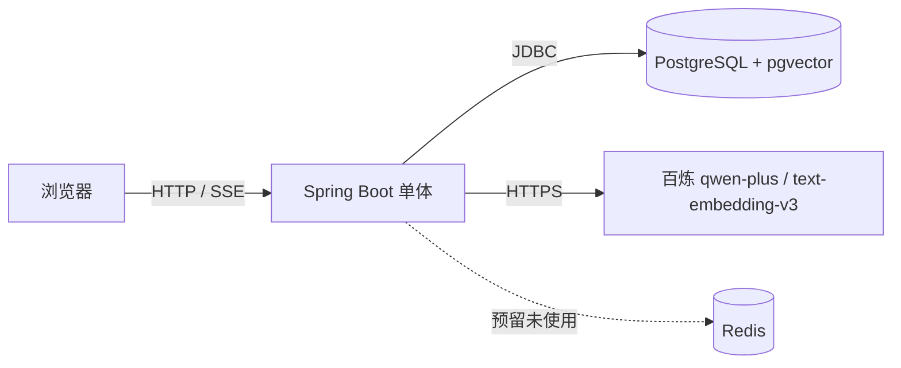

# 企业知识库 RAG 问答系统

一个基于 **RAG（检索增强生成）** 的企业知识库问答系统：上传文档后自动解析、清洗、切片、向量化，提问时通过 **向量 + BM25 混合检索** 召回片段，调用大模型生成带引用的回答，并支持流式输出与量化评测。

> 详细设计：[架构说明](docs/architecture.md) · 优化过程：[优化路线](docs/optimization-plan.md) · 失败分析：[难例分析](docs/failure-analysis.md) · 检索八股：[RAG 检索笔记](docs/ai-bagu-rag-retrieval.md)

---

## 1. 功能概览

- 文档上传（支持多选、异步索引、重建索引、删除）
- PDF / DOCX / Markdown / TXT 解析
- 文本清洗：去页眉页脚、页码、断行合并、重复行、全角归一化
- 切片：700 字 + 120 overlap（段落优先）
- 向量化：`text-embedding-v3`，1024 维，pgvector 存储
- 检索：向量召回 + BM25 词法召回 + RRF 融合
- 多意图查询拆解，提升跨文档问题召回
- 生成：qwen-plus，SSE 流式输出
- 引用：解析 `[n]`、后处理对齐、清理无效编号
- 拒答：资料不足时明确回答"资料中没有相关信息"
- 评测：150 题评测集 + 指标报告页
- 日志：`qa_log` 记录问题、召回片段、回答、耗时
- 工程化：单元测试、GitHub Actions、Docker Compose

---

## 2. 快速开始

### 方式一：本地开发（推荐）

```powershell
# 1. 只启动 PostgreSQL + Redis
docker compose up -d postgres redis

# 2. 本地启动应用
mvn spring-boot:run
```

### 方式二：全部容器化

```powershell
docker compose up -d --build
```

打开：

- 问答页：<http://localhost:8080/>
- 评测页：<http://localhost:8080/eval.html>

### API Key

在项目根目录 `.env` 中配置（已 gitignore）：

```properties
DASHSCOPE_API_KEY=sk-...
```

没有 Key 时会使用 Mock 实现，链路仍可启动，但回答是假的。

---

## 3. 系统架构



### 索引链路

```
上传
 → document(status=0)
 → @Async 索引
 → TextExtractor 解析（PDFBox/POI）
 → TextCleaner 清洗（页眉页脚/页码/断行/重复）
 → ChunkingService 切片（700 字，overlap 120）
 → Embedding（1024 维，批量 10 条）
 → chunk 表（vector + HNSW 余弦索引）
 → document(status=2, chunk_count=N)
失败 → status=3 + error_msg，可重建
```

### 检索与问答链路

```
问题
 → 多意图判断（QueryDecompositionService）
 → 子问题分别执行：
      向量召回（pgvector 余弦）
      + BM25 词法召回（中文二元组）
 → RRF 融合、去重、保证每个子查询 top1 进入候选
 → 阈值过滤（默认 0.5）+ topK
 → 拼带编号的 Prompt
 → qwen-plus 生成（SSE 流式）
 → 解析引用 + 对齐校验 + 清理无效编号
 → 回答 + 引用 + 写入 qa_log
```

---

## 4. 核心实现说明

### 4.1 解析与清洗

- PDF：PDFBox 按页解析，开启按位置排序、去重叠文本；
- DOCX：POI 按文档顺序读段落与表格；
- TXT/MD：UTF-8 严格解码，失败回退 GB18030；
- 旧版 `.doc` 不支持，需转 `.docx`；
- `TextCleaner` 在解析与切片之间执行，规则保守，避免误删正文。

### 4.2 切片

- 按页、按段落聚合；
- 单块上限 700 字，相邻块 120 字重叠；
- 保留页码，供引用定位；
- 当前未做语义切片、父子块、按条款切片，是后续优化方向。

### 4.3 混合检索

- **向量通道**：pgvector 余弦距离，`1 - distance` 作为相似度；
- **BM25 通道**：应用层实现，中文按字符二元组切词，不依赖分词器；
- **RRF 融合**：按排名融合两路结果，`k=60`；
- **多意图覆盖**：每个子查询的向量/BM25 第一名强制进入候选，避免被融合挤掉；
- 当前是应用层 BM25，全量扫描 chunk；规模变大应换 Elasticsearch / PG 中文全文索引。

### 4.4 生成与引用

- System Prompt 约束：只依据资料、必须引用、资料不足要拒答、不做法理推断；
- 温度 0.2，max tokens 800；
- 引用后处理：保留合法引用，按回答与片段重合度补齐，清理越界编号；
- 支持非流式与 SSE 流式两种接口。

### 4.5 评测

- 评测集 150 题：86 可答、40 跨文档、24 不可答，其中 80 道难例；
- 指标：Recall@K、跨文档召回、引用覆盖率、关键词正确率、拒答率、P95/平均延迟；
- 结果写入 `eval/report-*.csv`，页面读取 `report-latest.json`，只读不调模型；
- 评测按钮会真实调用模型，约 150 次问答。

---

## 5. 评测结果

评测条件：150 题（86 可答 / 40 跨文档 / 24 不可答，其中 80 道难例），`topK=8`，查询拆解 + 混合检索 + 引用对齐。

### 5.1 分阶段结果

| 阶段 | 主要改动 | Recall@8 | 跨文档 | 引用覆盖 | 正确率 | 拒答率 | P95 | 平均 |
|---|---|---|---|---|---|---|---|---|
| Prompt v1 | 初版拒答规则 | 1.000 | 0.975 | 0.984 | 0.992 | 0.958 | 11.4s | 3.8s |
| Prompt v2 | 否定结论、未规定不推断 | 1.000 | 0.975 | 0.976 | **1.000** | **1.000** | 10.9s | 4.2s |
| 跨文档修复 | 多意图判断、简洁子查询、top1 覆盖、引用补齐 | **1.000** | **1.000** | **1.000** | 1.000 | 1.000 | 11.4s | 4.0s |
| 阈值 0.5 | 阈值从 0.1 调到 0.5 | 1.000 | 1.000 | 1.000 | 1.000 | 1.000 | **9.9s** | **3.7s** |

关键结果：

- Prompt v2 修复了 `#127 宿舍受伤`（拒答过度）和 `#146 停工留薪期年假`（拒答不足）；
- 跨文档修复解决了 `#132/#136/#140` 三份文档只引两份、02 未进 topK 的问题，80 道难例全部通过；
- 阈值 0.1/0.3/0.5 指标一致，0.5 的 P95 最低，因此默认 0.5。

### 5.2 最终基线（150 题，topK=8，minScore=0.5）

| 指标 | 结果 |
|---|---|
| Recall@8 | 1.000 |
| 跨文档召回 | 1.000 |
| 引用覆盖率 | 1.000 |
| 关键词正确率 | 1.000 |
| 拒答准确率 | 1.000 |
| P95 延迟 | 9.9s |
| 平均延迟 | 3.7s |

阈值扫描（同一批 150 题）：

| minScore | Recall@8 | 跨文档 | 引用覆盖 | 正确率 | 拒答率 | P95 | 平均 |
|---|---|---|---|---|---|---|---|
| 0.1 | 1.000 | 1.000 | 1.000 | 1.000 | 1.000 | 11.4s | 4.0s |
| 0.3 | 1.000 | 1.000 | 1.000 | 1.000 | 1.000 | 11.5s | 4.0s |
| **0.5** | **1.000** | **1.000** | **1.000** | **1.000** | **1.000** | **9.9s** | **3.7s** |
| 0.7 | 1.000 | 0.950 | 0.984 | 1.000 | 0.958 | 10.2s | 3.6s |

结论：

- `0.1` 与 `0.5` 指标相同，但 `0.5` 候选更少、P95 更低，因此默认用 0.5；
- `0.7` 开始漏召回，说明阈值不能盲目调高；
- **当前评测已接近饱和**，且题目是自建的，1.0 不代表真实开放场景效果；后续要用更难的数据集、人工抽检和 Agent 任务评测补充。

> 指标来源：`docs/failure-analysis.md`（2026-11-05，150 题）。仓库中的 `eval/report-latest.json` 可能来自某次阈值扫描，评测页显示以其内容为准；正式基线以 0.5 为准。

---

## 6. 接口

| 方法 | 路径 | 说明 |
|---|---|---|
| GET | `/` | 问答页 |
| GET | `/eval.html` | 评测报告页 |
| GET | `/api/health` | 健康检查（含 DB） |
| POST | `/api/documents` | 上传文档（pdf/docx/md/txt） |
| GET | `/api/documents?kbId=1` | 文档列表 |
| GET | `/api/documents/{id}/status` | 文档状态 |
| POST | `/api/documents/{id}/reindex` | 重建索引 |
| DELETE | `/api/documents/{id}` | 删除文档（记录 + 切片 + 原文件） |
| GET | `/api/documents/{id}/chunks` | 查看切片 |
| GET/POST | `/api/search` | 检索（向量 + BM25 + RRF） |
| GET/POST | `/api/chat` | 非流式问答 |
| GET | `/api/chat/stream` | 流式问答（SSE） |
| GET | `/api/eval/latest` | 最近一次评测结果 JSON（只读） |
| GET | `/api/eval/report` | 下载最近一次评测 CSV（只读） |
| POST | `/api/eval/run?topK=8&minScore=0.5` | 触发评测（调用模型，需谨慎） |

SSE 事件：`meta`（检索结果）、`delta`（回答片段）、`done`（引用与清洗后的回答）、`error`。

---

## 7. 目录结构

```text
src/main/java/com/kagtro/rag/
├── ai/            模型客户端（DashScope / Mock）
├── chunk/         切片
├── config/        线程池配置
├── controller/    文档、检索、问答、评测、健康检查
├── dao/           Document / Chunk / Eval / QaLog
├── embedding/     向量化（DashScope / Mock）
├── parser/        解析（TextExtractor）+ 清洗（TextCleaner）
├── service/       索引、检索、BM25、查询拆解、问答、评测
└── RagApplication.java

src/main/resources/
├── application.yml
├── schema.sql
└── static/        问答页 + 评测页
```

关键文件：

| 关注点 | 文件 |
|---|---|
| 索引 | [IndexService.java](src/main/java/com/kagtro/rag/service/IndexService.java) |
| 解析/清洗 | [TextExtractor.java](src/main/java/com/kagtro/rag/parser/TextExtractor.java)、[TextCleaner.java](src/main/java/com/kagtro/rag/parser/TextCleaner.java) |
| 切片 | [ChunkingService.java](src/main/java/com/kagtro/rag/chunk/ChunkingService.java) |
| 混合检索 | [RetrievalService.java](src/main/java/com/kagtro/rag/service/RetrievalService.java)、[Bm25Retriever.java](src/main/java/com/kagtro/rag/service/Bm25Retriever.java) |
| 查询拆解 | [QueryDecompositionService.java](src/main/java/com/kagtro/rag/service/QueryDecompositionService.java) |
| 问答/引用 | [ChatService.java](src/main/java/com/kagtro/rag/service/ChatService.java) |
| 评测 | [EvalService.java](src/main/java/com/kagtro/rag/service/EvalService.java) |

---

## 8. 测试、CI 与部署

```powershell
# 目前 9 个纯逻辑单测：切片、清洗、查询拆解
mvn test
```

### P1 完成情况

| 项 | 状态 |
|---|---|
| `ChunkingServiceTest` | ✅ 3 个用例 |
| `TextCleanerTest` | ✅ 3 个用例 |
| `QueryDecompositionServiceTest` | ✅ 3 个用例 |
| `EvalService` 指标计算单测 | ⬜ 未补 |
| `ChatService` 引用对齐单测 | ⬜ 未补 |
| Dockerfile + compose app 服务 | ✅ |
| GitHub Actions `mvn test` | ✅ |
| `qa_log` 落库 | ✅ 问题、召回 ids、回答、总耗时 |
| token / 成本记录 | ⬜ 未接（字段预留） |

其他说明：

- GitHub Actions：push/PR 自动执行 `mvn test`；
- Dockerfile 多阶段构建，运行镜像只含 JRE；
- `docker compose up -d --build` 可启动 app + PostgreSQL + Redis；
- `uploads/` 通过 volume 挂载，容器重建不丢文件；
- `qa_log` 目前只记录问题、召回片段、回答和总耗时，token/成本待接入。

`qa_log` 排查：

```sql
select id, question, retrieved_ids, total_ms, created_at
from qa_log order by id desc limit 20;
```

---

## 9. 已知限制

- 没有登录/鉴权，`kbId` 由请求传入；
- Redis 已部署但暂未使用；
- BM25 为应用层实现，全量扫描 chunk，不适合大规模语料；
- 没有 rerank、没有 Agent、没有多轮会话；
- 没有 OCR，扫描版 PDF 解析为空；
- 评测集自建且接近饱和，1.0 不能代表真实开放场景；
- P1 仍有 `EvalService` / `ChatService` 引用对齐单测未补，`qa_log` 未记录 token/成本；
- `.doc` 旧格式不支持；单机部署，无高可用。

后续方向：难例评测、rerank、按条款切片、鉴权、Agent 工具调用。

---

## 10. 面试 3 分钟版

> "这是一个企业知识库 RAG 问答系统。写入侧：上传文档后异步解析、清洗、切片，用 text-embedding-v3 生成 1024 维向量存 PostgreSQL+pgvector，建 HNSW 余弦索引。读取侧：多意图问题先拆解，每个子问题做向量召回和 BM25 召回，用 RRF 融合，阈值过滤后拼成带编号的 Prompt，调 qwen-plus 流式生成，解析引用并做对齐校验。评测侧：150 道题，Recall@8 1.0、引用覆盖 1.0、拒答 1.0，P95 约 10 秒。当前主要问题是评测饱和、没有鉴权和重排，下一步做难例评测和 rerank。"
