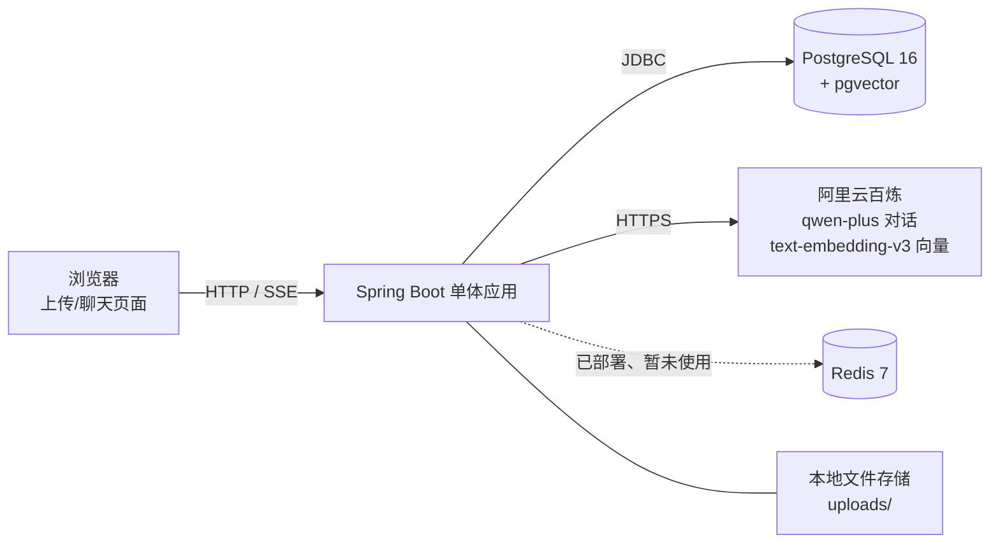
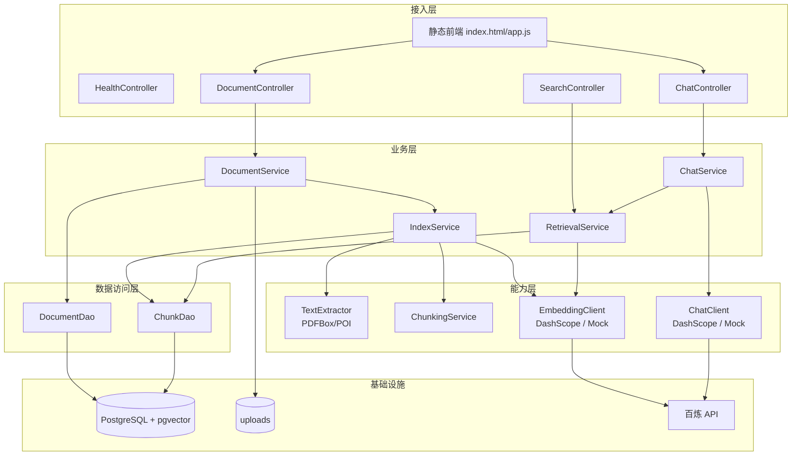
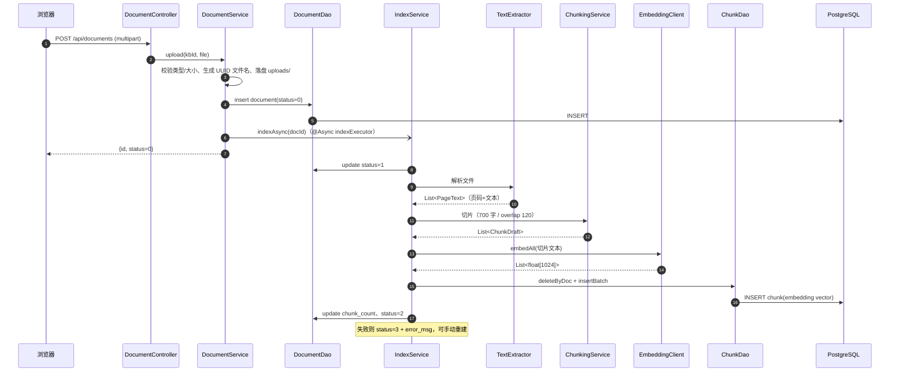
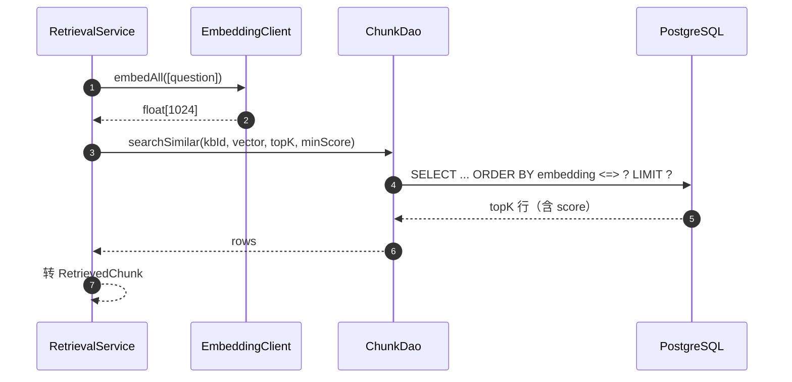
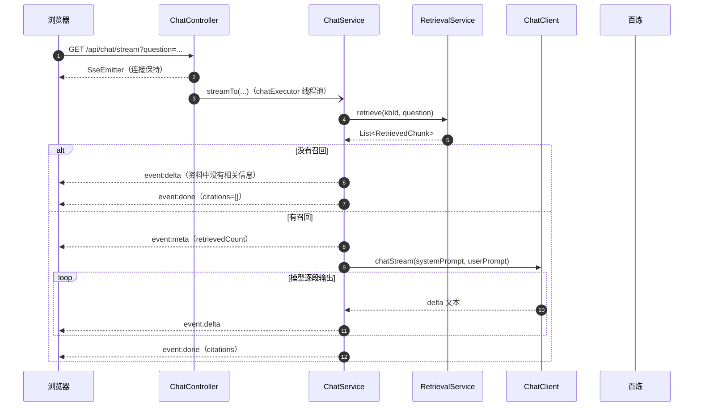
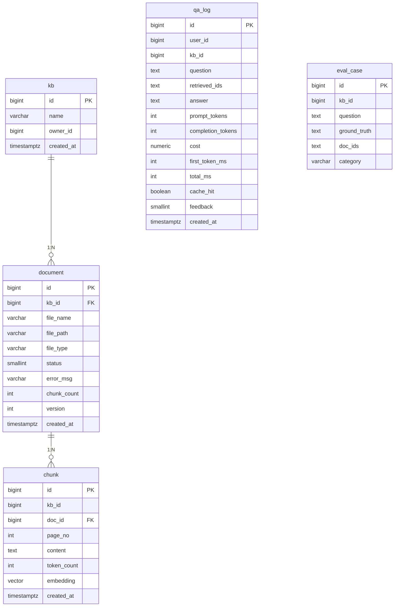

# 企业知识库 RAG 系统 · 架构说明

> 版本：v1.0（2026-11-02）
> 代码仓库：`E:\code\AI-RAG_training`（GitHub: Kagtro/AI-RAG_training）
> 用途：项目设计说明、面试讲解底稿、后续迭代依据

---

## 1. 项目目标与非目标

### 1.1 目标

做一个**可运行、可演示、可量化**的企业知识库问答系统：

- 支持 PDF / Word / Markdown / TXT 上传；
- 自动解析、切片、向量化并写入 PostgreSQL（pgvector）；
- 基于问题做语义检索，召回相关片段；
- 调用大模型生成**带引用**的回答，并支持 SSE 流式输出；
- 有基础的前端页面（文档管理 + 聊天）；
- 后续可接入评测集，量化召回率、正确率、拒答率、延迟和成本。

### 1.2 非目标（当前阶段明确不做）

- 不做微服务拆分（理由见 8.1）；
- 不做多租户/复杂权限（当前只有 `kb_id` 级别隔离）；
- 不做模型微调/训练；
- 不做多模态（图片、表格 OCR）；
- 不做高可用集群、K8s、分布式部署；
- 不做 Agent 自主规划（当前只做 RAG 问答）。

---

## 2. 系统上下文



说明：

- 应用是**单体**，一个进程同时提供页面、REST API、异步索引、流式问答；
- `Redis` 容器已启动，但**当前代码还没有使用**（预留给缓存/限流，见演进路线）；
- 大模型和 Embedding 都是外部 SaaS，通过 OpenAI 兼容 HTTP 接口调用；
- 上传的原始文件落在本地 `uploads/`，数据库只存路径。

---

## 3. 总体架构

### 3.1 分层



### 3.2 模块职责

| 包/目录 | 职责 | 说明 |
|---|---|---|
| `controller/` | HTTP 接口 | 只做参数接收、调用 Service、返回结果；不写业务 |
| `service/` | 业务编排 | DocumentService（上传）、IndexService（索引）、RetrievalService（检索）、ChatService（问答） |
| `parser/` | 文档解析 | PDFBox 解析 PDF（按页），POI 解析 DOCX（含表格） |
| `chunk/` | 文本切片 | 段落优先 + 滑动窗口 + overlap |
| `embedding/` | 向量化 | 接口 + 百炼实现 + Mock 实现 + 选择配置 |
| `ai/` | 大模型 | ChatClient 接口 + 百炼实现 + Mock 实现 + 参数配置 |
| `dao/` | 数据访问 | 只写 SQL，使用 Spring `JdbcClient` |
| `config/` | 配置 | 线程池、异步开关 |
| `resources/static/` | 前端 | 原生 HTML/CSS/JS，无框架 |
| `resources/schema.sql` | 建表 | 幂等 DDL + 表/字段注释 |
| `application.yml` | 配置 | 端口、数据库、AI、切片、检索参数 |

---

## 4. 代码结构

```text
src/main/java/com/kagtro/rag/
├── RagApplication.java              # 启动类
├── ai/                              # 大模型能力
│   ├── AiProperties.java            # 模型/参数配置
│   ├── ChatClient.java              # 接口：chat / chatStream
│   ├── ChatClientConfig.java        # 有 Key 用真实模型，否则 Mock
│   ├── DashScopeChatClient.java     # 百炼 Chat Completions（含 SSE）
│   └── MockChatClient.java          # 本地兜底
├── chunk/
│   ├── ChunkDraft.java              # 切片草稿
│   └── ChunkingService.java         # 切片算法
├── config/
│   └── AsyncConfig.java             # indexExecutor / chatExecutor
├── controller/
│   ├── HealthController.java        # /api/health
│   ├── DocumentController.java      # 上传/列表/状态/重建/切片
│   ├── SearchController.java        # /api/search
│   └── ChatController.java          # /api/chat、/api/chat/stream
├── dao/
│   ├── DocumentDao.java             # document 表
│   └── ChunkDao.java                # chunk 表 + 向量检索 SQL
├── embedding/
│   ├── EmbeddingClient.java         # 接口
│   ├── DashScopeEmbeddingClient.java# 百炼 Embedding
│   ├── MockEmbeddingClient.java     # 本地伪向量
│   └── EmbeddingConfig.java         # 选择实现
├── parser/
│   ├── PageText.java                # 页码 + 文本
│   └── TextExtractor.java           # PDF/DOCX/TXT/MD 解析
└── service/
    ├── DocumentService.java         # 上传、校验、落盘、触发索引
    ├── IndexService.java            # 异步索引编排
    ├── RetrievalService.java        # 向量检索 + 结果转换
    └── ChatService.java             # Prompt、生成、引用解析、流式
```

---

## 5. 核心链路

### 5.1 文档索引链路（写路径）



关键点：

- 上传接口**不等待**解析/向量化，避免请求超时；
- 文档状态：`0 待解析 / 1 解析中 / 2 已就绪 / 3 失败`；
- 重建索引 = 删除旧 chunk 后重新执行整条链路（换模型/改切片参数/文档更新时使用）；
- 切片保留页码，供回答引用溯源。

### 5.2 检索链路



SQL 核心：

```sql
select c.id, c.doc_id, c.page_no, c.content, d.file_name,
       1 - (c.embedding <=> CAST(:vector AS vector)) as score
from chunk c
join document d on d.id = c.doc_id
where c.kb_id = :kbId
  and d.status = 2
  and 1 - (c.embedding <=> CAST(:vector AS vector)) >= :minScore
order by c.embedding <=> CAST(:vector AS vector) asc
limit :topK
```

- `<=>`：pgvector 余弦距离，越小越相似；
- `1 - 距离`：相似度；
- `kb_id`：检索范围隔离；
- `status = 2`：只搜解析成功的文档；
- 阈值过滤：相似度太低直接丢弃，作为拒答的第一道防线。

### 5.3 问答链路（含流式）



Prompt 规则：

1. 只依据【资料】回答；
2. 每个事实后用 `[编号]` 标注来源；
3. 资料不足时回答"资料中没有相关信息"；
4. 温度 0.2，控制发散。

引用解析：正则匹配回答中的 `[n]`，只保留 `1 <= n <= 召回片段数` 的编号，映射回 chunk 的文件名/页码/分数。

---

## 6. 数据模型



| 表 | 状态 | 说明 |
|---|---|---|
| `kb` | 使用中 | 知识库；当前默认 id=1 |
| `document` | 使用中 | 原始文档 + 解析状态 |
| `chunk` | 使用中 | 切片 + 1024 维向量（HNSW 余弦索引） |
| `qa_log` | **已建表，未写入** | 预留给问答日志/成本/延迟统计 |
| `eval_case` | **已建表，未使用** | 预留给评测集 |

索引：

- `idx_chunk_embedding`：HNSW（`vector_cosine_ops`），加速向量检索；
- `idx_chunk_kb`、`idx_chunk_doc`：普通 B-Tree，用于过滤；
- `idx_document_kb`：按知识库查文档。

---

## 7. API 设计

| 方法 | 路径 | 说明 |
|---|---|---|
| GET | `/` | 前端页面（静态资源） |
| GET | `/api/health` | 健康检查（含数据库连通性） |
| POST | `/api/documents` | 上传文档（multipart，自动异步索引） |
| GET | `/api/documents?kbId=1` | 文档列表 |
| GET | `/api/documents/{id}/status` | 文档解析状态 |
| POST | `/api/documents/{id}/reindex` | 重建索引 |
| DELETE | `/api/documents/{id}` | 删除文档（记录 + 切片 + 原文件） |
| GET | `/api/documents/{id}/chunks` | 查看切片预览 |
| POST | `/api/search` | 检索（JSON：kbId/question/topK/minScore） |
| GET | `/api/search?question=...` | 检索（GET 调试） |
| POST | `/api/chat` | 非流式问答 |
| GET | `/api/chat?question=...` | 非流式问答（调试） |
| GET | `/api/chat/stream?question=...` | 流式问答（SSE） |

SSE 事件：

| 事件 | 数据 | 说明 |
|---|---|---|
| `meta` | `{"retrievedCount": N}` | 检索完成 |
| `delta` | `{"text": "..."}` | 回答片段 |
| `done` | `{"citations":[...],"retrievedCount":N}` | 生成结束 + 引用 |
| `error` | `{"msg":"..."}` | 异常 |

---

## 8. 技术选型与理由

### 8.1 为什么是单体，不是微服务

- 团队只有一个人，两周时间；
- 业务边界简单：索引 + 检索 + 问答，没必要引入注册中心/网关/链路追踪；
- 单体部署简单（一个 jar + 两个容器），排错成本低；
- 采用**模块化分包**（controller/service/parser/chunk/embedding/dao），保留未来拆分可能。

**面试回答**：先单体跑通业务，等"索引吞吐"和"在线问答"的扩缩容需求出现，再按这个边界拆成两个服务；现在拆是过度设计。

### 8.2 为什么用 PostgreSQL + pgvector

| 方案 | 优点 | 缺点 |
|---|---|---|
| **pgvector（选型）** | 少一个组件；业务表和向量同库，删文档可级联；SQL 熟悉；HNSW 够用 | 超大规模/高并发不如专用向量库 |
| Milvus | 专用向量库，规模大 | 组件重、运维成本高，两周项目不划算 |
| Elasticsearch kNN | 检索生态成熟 | 需要额外集群/调参，项目里已用 ES 的话更合适 |

当前数据量（个人项目）用 pgvector 完全够，且"少一个组件"对两周项目非常重要。

### 8.3 为什么用 `@Async` 而不引入 Kafka

- 索引是"解析 + Embedding"的秒级到分钟级任务，用线程池即可；
- Kafka 需要额外部署、序列化、消费组、重试/死信，增加联调成本；
- 当前用"任务状态字段 + 手动重建"保证可恢复。

**演进**：上量后改为"本地消息表（outbox）→ Kafka → 幂等消费"，索引任务可重试、可并行、可观测。

### 8.4 为什么用 SSE 而不是 WebSocket

- 问答是**单向**流式输出（服务端 → 浏览器），不需要双向通信；
- SSE 基于 HTTP，浏览器用 `EventSource` 即可，服务端用 `SseEmitter`；
- WebSocket 更重，还要处理心跳、重连、协议升级。

注意：`EventSource` 只支持 GET，所以流式接口设计为 GET + query 参数。

### 8.5 为什么有 Mock 实现

- 没有 API Key 时也能跑通"上传→索引→检索→问答"整条链路；
- 方便演示、方便别人克隆项目后启动；
- 有 Key 时自动切换真实实现（配置驱动）。

### 8.6 配置与密钥

- 密钥放项目根目录 `.env`，通过 `spring.config.import` 加载；
- `.env` 已加入 `.gitignore`，不提交；
- 生产环境可改用环境变量或配置中心。

### 8.7 检索参数

| 参数 | 当前值 | 说明 |
|---|---|---|
| `rag.chunk-size` | 700 | 切片大小（字符） |
| `rag.chunk-overlap` | 120 | 相邻切片重叠 |
| `rag.top-k` | 5 | 召回数量 |
| `rag.score-threshold` | 0.1 | 阈值；**真实 Embedding 下偏低，需用评测集调到 0.4~0.6** |
| `ai.embedding-dimension` | 1024 | text-embedding-v3 维度 |
| `ai.temperature` | 0.2 | 生成温度 |
| `ai.max-tokens` | 800 | 回答最大长度 |

---

## 9. 关键设计决策

1. **上传与索引异步解耦**：接口只负责落盘 + 建记录，索引后台执行，状态可轮询；
2. **切片保留页码**：回答引用能定位到原文页；
3. **检索 SQL 带 `kb_id` 和 `status` 过滤**：范围隔离 + 不搜脏数据；
4. **阈值过滤前置**：低相似度不进入 Prompt，降低幻觉；
5. **Prompt 强制引用 + 拒答**：资料不足时明确说"没有相关信息"；
6. **引用二次校验**：只接受 `[1..N]` 范围内的编号，防止模型编造来源；
7. **流式输出用独立线程池**：不阻塞 Tomcat 线程，索引与问答互不影响；
8. **索引失败落状态**：`status=3 + error_msg`，可手动重建，不静默失败；
9. **Mock 降级**：无 Key 也能演示完整链路；
10. **不引入消息队列**：以最小复杂度完成当前目标，演进方案明确。

---

## 10. 非功能与当前限制

### 10.1 安全

- **没有登录/鉴权**：所有 API 公开，`kbId` 由请求传入，存在越权风险；
- 没有用户表、没有文档级 ACL；
- 前端与后端同源，未配置 CORS；
- `.env` 未提交，但 API Key 曾出现在聊天中，建议轮换。

### 10.2 可靠性

- Embedding/Chat 有 3 次重试；流式接口失败发 `error` 事件；
- 索引失败可手动重建；没有自动重试/死信队列；
- 没有幂等键，重复上传会重复索引；
- 没有并发限制。

### 10.3 性能

- 单机、单实例；没有压测数据；
- HNSW 索引已建，但 topK/阈值未调优；
- 没有缓存（Redis 未使用）、没有限流；
- 切片/嵌入是串行批处理，文档大时索引较慢。

### 10.4 可观测性

- 只有应用日志；
- `qa_log` 已建表但未写入，缺少 token/成本/延迟统计；
- 没有指标监控、链路追踪。

### 10.5 测试

- 目前没有单元测试/集成测试；
- 主要靠 curl + 页面手工验证。

### 10.6 文档处理限制

- 扫描版 PDF 没有文字层 → 解析为空，索引失败（暂不支持 OCR）；
- DOCX 不保留页码（统一记为第 1 页）；
- 不支持表格结构化解析、图片、公式。

---

## 11. 部署与运行

### 11.1 本地开发

```bash
# 1. 启动中间件（PostgreSQL + pgvector、Redis）
docker compose up -d

# 2. 启动应用
mvn spring-boot:run

# 3. 打开页面
http://localhost:8080
```

### 11.2 容器与端口

| 容器 | 镜像 | 端口 | 数据卷 |
|---|---|---|---|
| `rag-postgres` | `pgvector/pgvector:pg16` | 5432 | `pgdata` |
| `rag-redis` | `redis:7-alpine` | 6379 | `redisdata` |

### 11.3 配置来源

- `application.yml`：通用配置；
- `.env`：本地密钥（不提交）；
- 生产：环境变量 / 配置中心。

### 11.4 后续部署方案（未实现）

- 应用打 jar 或 Docker 镜像；
- Nginx 反代 + 静态资源；
- 数据库备份、监控告警、日志收集。

---

## 12. 演进路线

| 阶段 | 内容 | 目的 |
|---|---|---|
| P1（当前） | 索引 + 检索 + 问答 + 前端 + 流式 | 跑通闭环、可演示 |
| P2 | 评测集（30 条）+ 指标（Recall@K/正确率/拒答率/P95/成本）+ 阈值调优 | 证明效果 |
| P3 | `qa_log` 落库、删除文档、多知识库、缓存/限流 | 工程化 |
| P4 | Rerank、混合检索（BM25+向量）、OCR、文档版本 | 效果提升 |
| P5 | 鉴权/权限、Kafka/outbox、监控、CI/CD、部署 | 生产化 |

---

## 13. 面试讲解要点（3 分钟版）

> "这是一个企业知识库 RAG 系统，后端用 Spring Boot 单体 + PostgreSQL/pgvector，前端原生 JS。
> 写路径：上传文档后异步解析、切片、调用 Embedding 写入向量库，文档状态可轮询；
> 读路径：问题向量化 → 余弦检索 topK → 阈值过滤 → 拼带编号的资料 Prompt → 调 qwen-plus 流式生成 → 解析 `[n]` 引用映射回原文页码。
> 关键取舍：单体而不是微服务、pgvector 而不是 Milvus、@Async 而不是 Kafka、SSE 而不是 WebSocket；
> 目前已知不足：没有鉴权、没有评测、阈值没调优、Redis 还没用起来；下一步先做评测集和日志。"

如果被追问：

- "为什么不用微服务？" → 见 8.1；
- "怎么保证不瞎编？" → 阈值 + 只给资料 + 强制引用 + 拒答 + 引用二次校验；
- "怎么证明有效？" → 目前没有，下一步做 30 条评测集算 Recall@K/正确率/拒答率；
- "数据量大了怎么办？" → 先调 HNSW 参数/加副本，再考虑独立向量库；索引服务可拆。

---

## 附录 A：配置项

| 配置 | 默认值 | 位置 |
|---|---|---|
| `server.port` | 8080 | application.yml |
| `spring.datasource.url` | `jdbc:postgresql://localhost:5432/rag` | application.yml |
| `spring.sql.init.mode` | always | application.yml |
| `spring.config.import` | `optional:file:./.env[.properties]` | application.yml |
| `rag.upload-dir` | `E:/code/AI-RAG_training/uploads` | application.yml |
| `rag.chunk-size` | 700 | application.yml |
| `rag.chunk-overlap` | 120 | application.yml |
| `rag.top-k` | 5 | application.yml |
| `rag.score-threshold` | 0.1 | application.yml |
| `ai.base-url` | 百炼兼容地址 | application.yml |
| `ai.chat-model` | qwen-plus | application.yml |
| `ai.embedding-model` | text-embedding-v3 | application.yml |
| `ai.embedding-dimension` | 1024 | application.yml |
| `ai.temperature` | 0.2 | application.yml |
| `ai.max-tokens` | 800 | application.yml |

## 附录 B：关键文件索引

| 关注点 | 文件 |
|---|---|
| 启动 | `RagApplication.java` |
| 建表 | `resources/schema.sql` |
| 配置 | `resources/application.yml` |
| 上传/索引 | `DocumentController`、`DocumentService`、`IndexService` |
| 解析/切片 | `TextExtractor`、`ChunkingService` |
| 向量化 | `EmbeddingClient`、`DashScopeEmbeddingClient` |
| 检索 SQL | `ChunkDao.searchSimilar` |
| 问答/引用 | `ChatService`、`ChatController` |
| 前端 | `static/index.html`、`static/js/app.js` |
