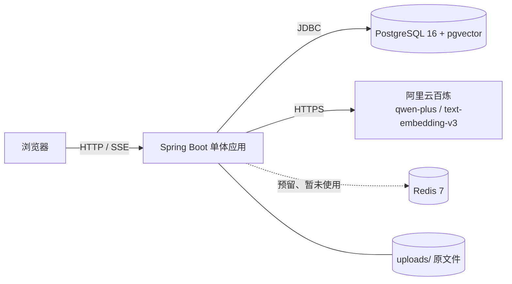
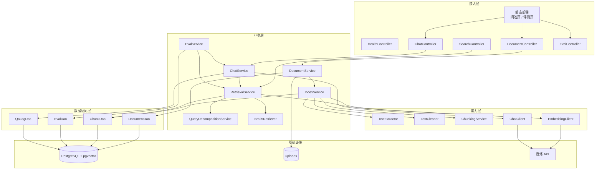
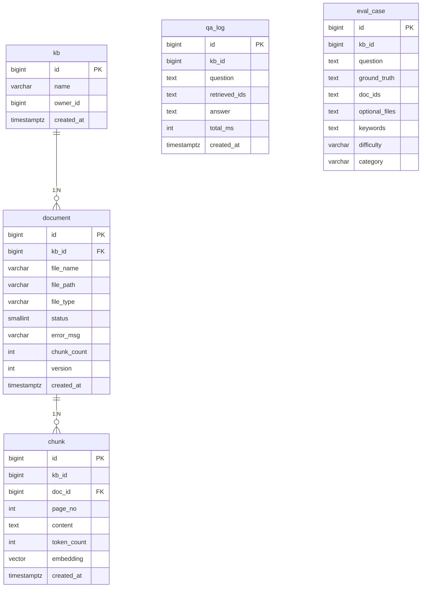
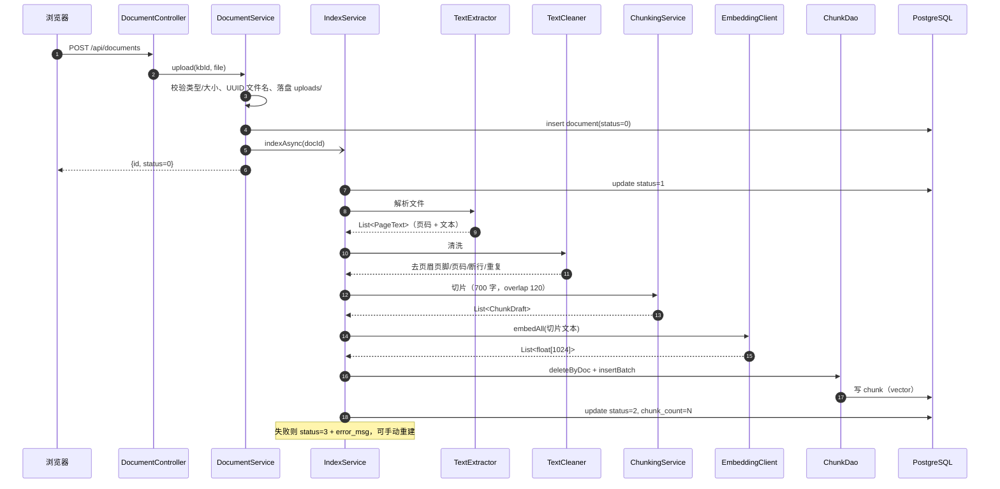
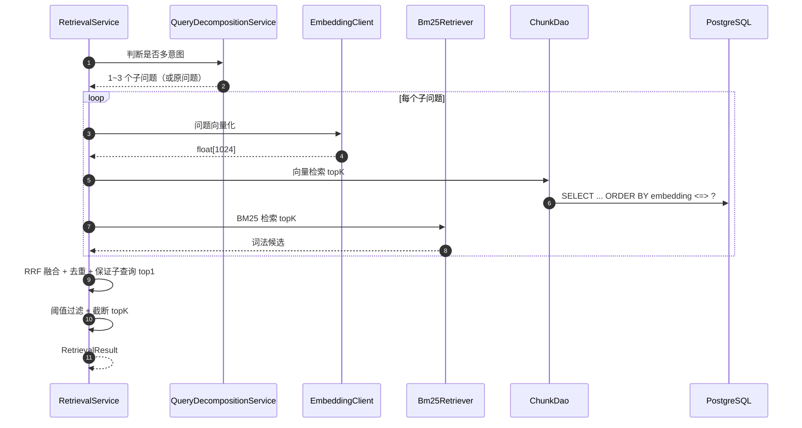
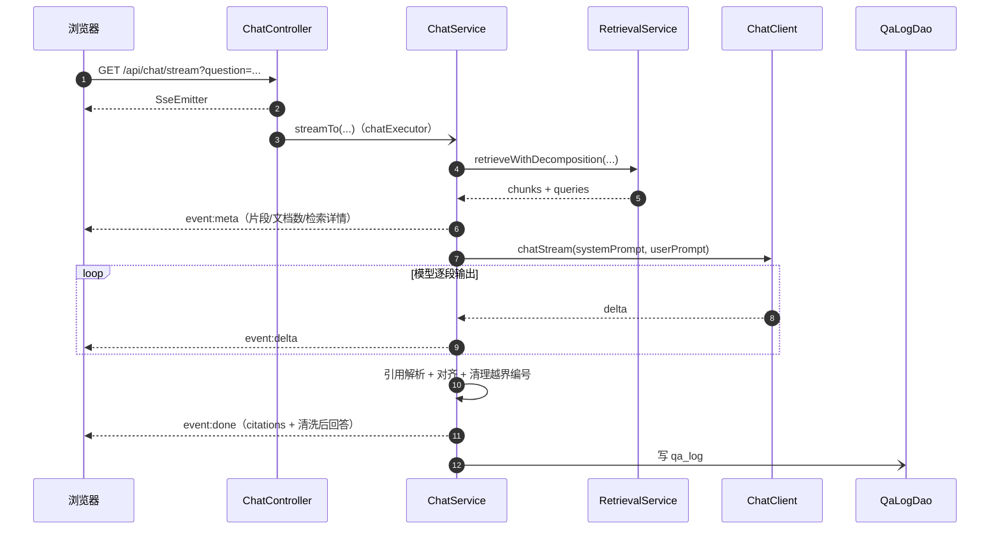

# 企业知识库 RAG 问答系统 · 架构说明

> 版本：v2.0（2026-11-11）
> 仓库：`E:\code\AI-RAG_training`（GitHub: Kagtro/AI-RAG_training）
> 用途：设计说明、答辩/面试底稿、后续迭代依据
>
> 配套文档：快速开始与接口见 [README](../README.md)；优化过程见 [optimization-plan.md](optimization-plan.md)；难例分析见 [failure-analysis.md](failure-analysis.md)。

---

## 1. 目标与非目标

### 1.1 目标

做一个**可运行、可演示、可量化、可维护**的企业知识库问答系统：

- 支持 PDF / DOCX / Markdown / TXT 上传；
- 自动解析、清洗、切片、向量化并写入 PostgreSQL（pgvector）；
- 问题侧支持多意图拆解、向量 + BM25 混合检索、RRF 融合；
- 调用大模型生成带引用的回答，支持 SSE 流式输出；
- 有可用的文档管理、聊天、评测页面；
- 有可重复的评测集和指标，能支撑优化对比。

### 1.2 非目标（当前不做）

- 不做微服务拆分、K8s、分布式索引；
- 不做多租户 / 复杂 RBAC（只有 `kb_id` 级隔离）；
- 不做模型微调/训练；
- 不做多模态、OCR、表格结构化；
- 不做 Agent 自主规划（当前是 RAG 问答，不是 Agent）；
- 不做可视化工作流编辑器。

---

## 2. 系统上下文



- 单体应用同时提供页面、REST API、异步索引、流式问答；
- 文件本体在 `uploads/`（容器内挂载 volume），数据库只存元数据、切片与向量；
- Redis 容器已部署，但当前代码未使用，预留给缓存/限流/会话；
- 模型与 Embedding 都是外部 SaaS，通过 OpenAI 兼容 HTTP 接口调用。

---

## 3. 分层架构



### 模块职责

| 包 | 职责 |
|---|---|
| `controller/` | HTTP 接口：文档、检索、问答、评测、健康检查 |
| `service/` | 业务编排：上传、索引、检索、BM25、查询拆解、问答、评测 |
| `parser/` | `TextExtractor` 解析 PDF/DOCX/TXT/MD；`TextCleaner` 清洗 |
| `chunk/` | 段落聚合 + 滑动窗口切片 |
| `embedding/` | Embedding 接口、百炼实现、Mock 实现、选择配置 |
| `ai/` | ChatClient 接口、百炼实现、Mock 实现、模型参数 |
| `dao/` | JdbcClient 访问 document / chunk / eval_case / qa_log |
| `config/` | `indexExecutor`、`chatExecutor` 线程池 |
| `resources/static/` | 原生 HTML/CSS/JS：问答页、评测页 |

---

## 4. 代码结构

```text
src/main/java/com/kagtro/rag/
├── RagApplication.java
├── ai/
│   ├── AiProperties.java
│   ├── ChatClient.java              # chat / chatStream
│   ├── ChatClientConfig.java
│   ├── DashScopeChatClient.java
│   └── MockChatClient.java
├── chunk/
│   ├── ChunkDraft.java
│   └── ChunkingService.java
├── config/
│   └── AsyncConfig.java             # indexExecutor / chatExecutor
├── controller/
│   ├── HealthController.java
│   ├── DocumentController.java
│   ├── SearchController.java
│   ├── ChatController.java
│   └── EvalController.java
├── dao/
│   ├── DocumentDao.java
│   ├── ChunkDao.java                # 向量检索 SQL + BM25 取数
│   ├── EvalDao.java
│   └── QaLogDao.java
├── embedding/
│   ├── EmbeddingClient.java
│   ├── DashScopeEmbeddingClient.java
│   ├── MockEmbeddingClient.java
│   └── EmbeddingConfig.java
├── parser/
│   ├── PageText.java
│   ├── TextExtractor.java
│   └── TextCleaner.java
└── service/
    ├── DocumentService.java
    ├── IndexService.java
    ├── RetrievalService.java
    ├── Bm25Retriever.java
    ├── QueryDecompositionService.java
    ├── ChatService.java
    └── EvalService.java
```

---

## 5. 数据模型



关键点：

- `document.status`：`0 待解析 / 1 解析中 / 2 已就绪 / 3 失败`；
- `chunk.embedding vector(1024)`，HNSW 余弦索引；
- `chunk.doc_id` 外键 `ON DELETE CASCADE`，删文档自动删切片；
- `eval_case` 支持必选文档、可选文档、关键词、难度、类别；
- `qa_log` 记录问题、召回片段 id、回答、耗时；token/成本字段预留。

---

## 6. 核心链路

### 6.1 索引链路（写）



设计要点：

- 上传接口不等待解析/Embedding，避免超时；
- 重建索引会删除旧 chunk 后重新执行整条链路；
- 切片保留页码，引用可定位到原页；
- 向量化批量 10 条，失败重试 3 次；
- 当前插入是逐条 SQL，规模大时可改批量写入。

### 6.2 检索链路（读）



关键设计：

- **查询拆解**：
  - 先做低成本判断（"分别/各自/以及"、两个问号、顿号 + 多个疑问词、长问题含"和/与"）；
  - 命中多意图才调用 LLM，输出 JSON 子问题数组；
  - 解析失败时按"和/与"规则拆分；
  - 结果用 ConcurrentHashMap 缓存，避免重复调用。
- **向量召回**：pgvector 余弦距离 `<=>`，相似度 `1 - distance`；
- **BM25**：应用层实现，中文按字符二元组切词（不依赖分词器），K1=1.5、B=0.75；
- **RRF**：`score = Σ 1/(60 + rank)`，只使用排名，避免分数量纲问题；
- **多意图覆盖**：每个子查询的向量/BM25 top1 强制进入候选，防止被融合挤掉；
- **阈值**：默认 0.5，低于阈值的片段不进入 Prompt；
- **未实现 rerank**：当前是"召回后直接生成"，候选里没有精排模型。

### 6.3 生成链路（含流式）



Prompt 规则：

1. 只依据资料回答，不使用资料外知识；
2. 每个事实后用 `[编号]` 标注来源；
3. 资料不足时回答"资料中没有相关信息"；
4. 资料没有直接规定时，不要用法理/常识推断；
5. 资料给出认定/排除条件、事实明显不符合时，应给出否定结论；
6. 温度 0.2，max tokens 800。

引用后处理：

- 正则解析 `[n]`；
- 只保留 `1~N`；
- 用回答与片段的字符二元组重合度校验模型引用，过滤引错；
- 对缺失/错误引用，补 1~2 个最相关且不同文档的片段；
- 清理回答中不存在/未通过校验的编号。

### 6.4 评测与日志

- 评测集 150 题：86 可答 / 40 跨文档 / 24 不可答，其中 80 道难例；
- `EvalService` 逐题执行：检索 → 判断期望文档是否命中 → 问答 → 关键词/拒答判断 → 延迟；
- 指标：
  - `Recall@K`：期望文档是否进前 K；
  - `crossRecallAtK`：跨文档题是否覆盖多份文档；
  - `groundedness`：回答引用是否覆盖期望文档；
  - `answerAccuracy`：关键词粗筛；
  - `refusalAccuracy`：不可答题是否正确拒答；
  - `P95/avg latency`；
- 输出 `eval/report-*.csv` + `report-latest.json`；
- 评测页只读报告，不调模型；`POST /api/eval/run` 才会触发真实评测；
- `qa_log` 由 `QaLogDao` 写入，失败不影响主流程。

---

## 7. 关键设计决策

| 决策 | 选择 | 理由 |
|---|---|---|
| 架构 | 单体 Spring Boot | 个人项目，边界简单；拆微服务是过度设计 |
| 向量库 | PostgreSQL + pgvector | 少一个组件，业务表/向量同库，删文档可级联 |
| 索引 | `@Async` 线程池 | 秒级到分钟级任务，不需要 Kafka |
| 检索 | 向量 + BM25 + RRF | 语义与词法互补，RRF 不依赖分数量纲 |
| 查询拆解 | LLM + 规则兜底 + 缓存 | 多意图问题单向量会被一个意图主导 |
| 生成 | qwen-plus，SSE | 流式体验好，OpenAI 兼容易替换 |
| 引用 | 后处理对齐 | Prompt 约束不能保证模型一定写对 |
| 阈值 | 0.5 | 0.1~0.5 指标一致，0.5 延迟更低；0.7 开始漏召回 |
| Mock 实现 | 无 Key 可跑通 | 方便演示与别人克隆启动 |

---

## 8. 工程化与部署

### 8.1 P1 完成情况

| 项 | 状态 |
|---|---|
| `ChunkingServiceTest` | ✅ 3 个用例 |
| `TextCleanerTest` | ✅ 3 个用例 |
| `QueryDecompositionServiceTest` | ✅ 3 个用例 |
| `EvalService` 指标计算单测 | ✅ 1 个用例 |
| `ChatService` 引用对齐单测 | ✅ 2 个用例 |
| Dockerfile + compose app 服务 | ✅ |
| GitHub Actions `mvn test` | ✅ |
| `qa_log` 落库 | ✅ 问题、召回 ids、回答、总耗时 |
| token / 成本记录 | ⬜ 未接（字段预留） |

### 8.2 部署与运行

- **单元测试**：4 个测试类、12 个用例（切片、清洗、查询拆解、引用对齐、评测指标），`mvn test`；
- **CI**：GitHub Actions push/PR 自动跑测试；
- **Docker**：多阶段构建，运行镜像只含 JRE；
- **Compose**：app + PostgreSQL + Redis，`uploads/` 挂载 volume；
- **配置**：`.env` 加载 `DASHSCOPE_API_KEY`，已 gitignore；
- **健康检查**：`/api/health`、`/actuator/health`；
- **日志**：`qa_log` 记录问答；token/成本字段预留。

---

## 9. 当前指标与局限

### 9.1 指标（150 题，topK=8，minScore=0.5）

| 指标 | 结果 |
|---|---|
| Recall@8 | 1.000 |
| 跨文档召回 | 1.000 |
| 引用覆盖率 | 1.000 |
| 关键词正确率 | 1.000 |
| 拒答准确率 | 1.000 |
| P95 / 平均延迟 | 9.9s / 3.7s |

> 详细阈值扫描与失败案例见 [failure-analysis.md](failure-analysis.md)。

### 9.2 局限

- **评测饱和**：自建 150 题全 1.0，不能代表开放场景；下一步要更难的数据集/人工抽检；
- **无鉴权**：`kbId` 由请求传入，存在越权风险；
- **无 rerank**：召回后直接生成，精度依赖召回；
- **BM25 应用层实现**：全量扫描 chunk，规模大要换 ES/PG 全文索引；
- **无 OCR**：扫描版 PDF 解析为空；
- **无多轮会话/Agent**：当前是单轮 RAG；
- **无监控/成本统计**：qa_log 只有耗时，token/成本未接；
- **单机部署**：没有高可用、限流、缓存。

### 9.3 演进路线

1. 难例评测 + 人工抽检（先让指标可信）；
2. rerank（召回 top 20~30 → 精排 top 3~5）；
3. 按"第 X 条"结构切片 + 父子块；
4. 鉴权 / 多知识库 / 限流 / 缓存；
5. Agent 工具调用（在 RAG 之上加工具循环与轨迹）；
6. OCR / 表格 / 多格式。

---

## 10. 面试讲解（3 分钟）

> "这是一个企业知识库 RAG 系统。写入侧：上传后异步解析、清洗、切片，用 text-embedding-v3 生成 1024 维向量，存 PostgreSQL+pgvector 并建 HNSW 索引。读取侧：多意图问题先拆解，每个子问题做向量召回和 BM25 召回，用 RRF 融合，阈值过滤后拼带编号的 Prompt，调 qwen-plus 流式生成，解析引用并做对齐校验。评测侧：150 道题、80 道难例，Recall@8 1.0、引用覆盖 1.0、拒答 1.0，P95 约 10 秒。当前主要问题是评测饱和、没有鉴权和重排，下一步做难例评测和 rerank。"

---

## 附录：配置项

| 配置 | 默认值 | 说明 |
|---|---|---|
| `server.port` | 8080 | 应用端口 |
| `spring.datasource.url` | `jdbc:postgresql://localhost:5432/rag` | 数据库 |
| `rag.upload-dir` | `E:/code/AI-RAG_training/uploads` | 文件目录 |
| `rag.chunk-size` | 700 | 切片大小 |
| `rag.chunk-overlap` | 120 | 重叠字符 |
| `rag.top-k` | 5 | 线上默认召回数（评测用 8） |
| `rag.score-threshold` | 0.5 | 相似度阈值 |
| `rag.query-decomposition-enabled` | true | 查询拆解开关 |
| `rag.hybrid-enabled` | true | 混合检索开关 |
| `ai.chat-model` | qwen-plus | 对话模型 |
| `ai.embedding-model` | text-embedding-v3 | 向量模型 |
| `ai.embedding-dimension` | 1024 | 向量维度 |
| `ai.temperature` | 0.2 | 生成温度 |
| `ai.max-tokens` | 800 | 回答最大长度 |
